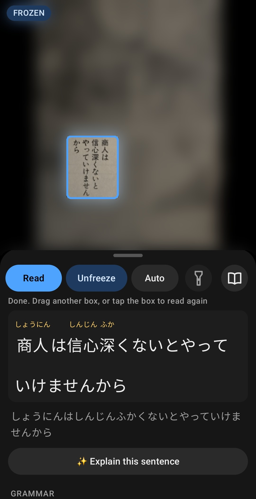
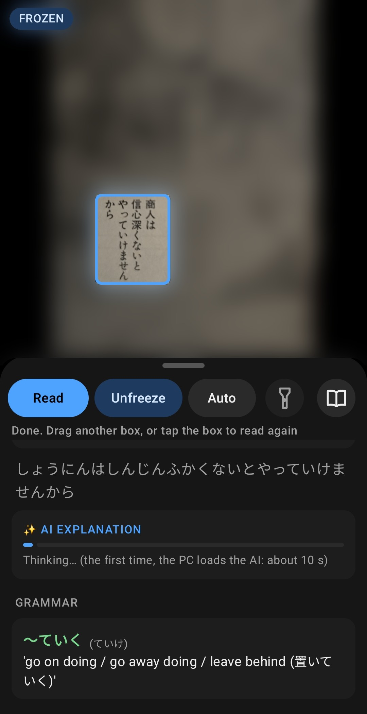
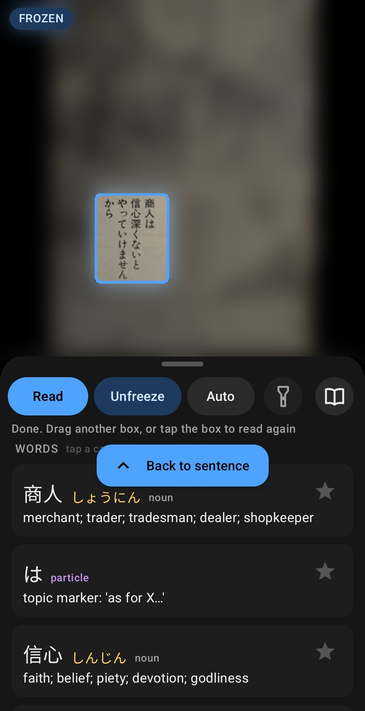
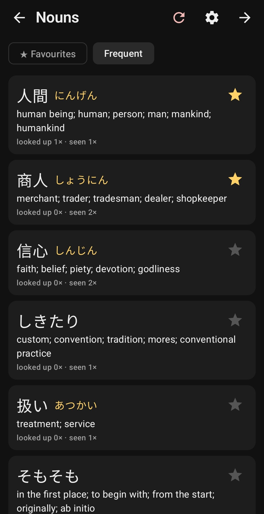
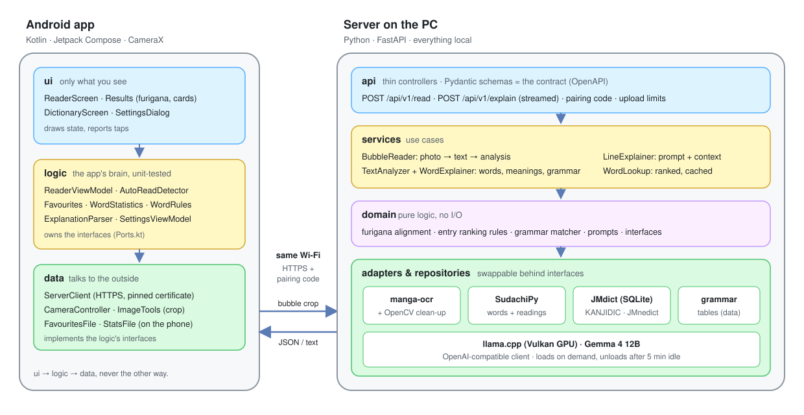

# manga-ocr-reader

**Point your phone at a page of a physical Japanese manga and get furigana, readings, dictionary entries, grammar notes and an AI explanation of the bubble. It runs entirely on your own PC: offline, free, no cloud APIs.**

[](https://github.com/Aimelec/manga-ocr-reader/actions/workflows/ci.yml)

<p align="center">
  
  
  
  
</p>

## The problem

I'm a manga and anime fan, and I've been studying Japanese for several years. When I started buying manga in the original language, I hit a wall: **the kanji**. The apps that promise to add furigana from a photo mostly didn't work for me. They misread characters, especially in vertical text and stylized fonts, and they felt buggy. A wrong character means a wrong reading and a wrong dictionary entry, which is worse than nothing when you're trying to learn.

So I built my own, with a different approach:

- **Precision first.** A model trained specifically on manga text ([manga-ocr](https://github.com/kha-white/manga-ocr)) reads the bubble. A proper morphological analyzer ([SudachiPy](https://github.com/WorksApplications/SudachiPy)) splits the words and gives readings, and the readings are aligned so furigana sits only over the kanji.
- **Explain, don't just translate.** The goal is to *learn to read*, not to skip the Japanese. Every word links to its dictionary entry and kanji details, particles and grammar patterns are explained, and on request a **local LLM** explains the bubble: translation, a literal version that shows the structure, and notes on tone, idioms and omitted subjects.
- **Offline, on my own PC.** OCR, dictionary and LLM all run locally (the LLM on the GPU through llama.cpp). No per-request cost, no account, nothing leaves the home network.
- **Built for studying.** Words you meet are counted automatically. A *Frequent* dictionary shows what keeps coming up in what you read, and you can star words and mark them as known.

## What it does

| | |
|---|---|
| **Read a bubble** | Live camera with tap-to-focus, or **Freeze** the page and drag a box around a bubble. **Auto** mode reads as soon as you hold still over a new bubble. |
| **Furigana & readings** | The sentence with furigana over the kanji only (食べる → 食[た]べる), plus the whole line in hiragana. |
| **Word cards** | Part of speech and conjugation, ranked JMdict entries (the entry that fits the sentence comes first), kanji meanings with on/kun readings, and long compounds broken into parts. |
| **Grammar** | Particles and auxiliaries explained, plus ~40 grammar patterns (〜ている, 〜てしまう, 〜かもしれない, しか〜ない…). |
| **✨ AI explanation** | On demand, streamed: translation, literal rendering, notes. The model also gets the previous bubbles as context, and flags likely OCR mistakes. |
| **My words** | ★ Favourites, plus an automatic *Frequent* dictionary with example sentences, kept on the phone. |

## How it works



The phone does the camera work and the UI. The PC does the heavy lifting.

1. The app crops the bubble out of a full-resolution photo and sends it over HTTPS on the local network. It pins the server's self-signed certificate on first use, and every request carries a **pairing code** shown in the server window.
2. `POST /api/v1/read`: the photo is cleaned up (grayscale, CLAHE, upscaling small crops), **manga-ocr** reads it, **SudachiPy** splits it into words with readings, the furigana is aligned, **JMdict / KANJIDIC / JMnedict** provide meanings, and the grammar patterns are matched.
3. `POST /api/v1/explain`: the line, the previous bubbles and our own word analysis go to **Gemma 4 12B** running in **llama.cpp** (Vulkan). The answer streams back as it's written. The model loads on the first request and unloads after 5 idle minutes, so the GPU is free the rest of the time.

The API contract is described in [`contract/openapi.json`](contract/openapi.json). The app's parser is tested against a real server response ([`contract/read_response.example.json`](contract/read_response.example.json)), so the two sides can't drift apart.

### Code structure

Both sides use the same layering, and dependencies only point inwards:

| | Server (`backend/`) | App (`android/…/local/`) |
|---|---|---|
| Edge | `api/`: thin FastAPI controllers, Pydantic schemas | `ui/`: Compose screens, only draw state |
| Use cases | `services/`: BubbleReader, TextAnalyzer, LineExplainer | `logic/`: ReaderViewModel, AutoReadDetector, Favourites… |
| Rules | `domain/`: furigana, ranking, grammar, prompts, **interfaces** | `logic/Ports.kt`: **interfaces** |
| Outside world | `adapters/` + `repositories/`: manga-ocr, Sudachi, llama.cpp, JMdict | `data/`: server client, camera, files |
| Wiring | `container.py` (the only place that picks implementations) | `MainActivity.kt` |

Swapping the OCR engine, tokenizer, dictionary or LLM backend means one new class chosen in `container.py`. Any OpenAI-compatible server works for the LLM. Grammar patterns and entry-ranking rules are data or small functions, so adding one doesn't touch the others.

## Choosing the model

Picking the explanation model was an experiment of its own: [`llm/test_models.py`](llm/test_models.py) runs every model on the same [test lines](llm/test_lines.json) (archaic speech, rough speech, idioms, a proverb, an OCR mistake, reading choices…), and the full answers are in [`llm/results/`](llm/results/).

| Model (GGUF) | Speed on RX 9070 XT | Archaic and idiomatic lines |
|---|---|---|
| **Gemma 4 12B Q5_K_M** ✅ | 3.7 s/line · 59 tok/s | Correct, including set phrases like 礼には及ばぬ ("no need for thanks") |
| Qwen3 14B Q4_K_M | 2.7 s/line · 64 tok/s | Got the meaning of 礼には及ばぬ backwards |
| Qwen3.5 9B Q6_K | 2.5 s/line · 76 tok/s | Fastest, but invented words that aren't in the line |

The faster models were confidently wrong on exactly the lines a learner needs help with, so Gemma won. Q5_K_M was as good as Q6_K and faster ([comparison](llm/results/report_gemma_q5_vs_q6.md)).

A second experiment ([`llm/test_context.py`](llm/test_context.py), [results](llm/results/report_context.md)) checked whether the model should get our own word analysis. Giving it **readings and dictionary forms** helps. Giving it **dictionary meanings** too made it worse, because it latched onto the first, often wrong, sense. The server sends the first kind only.

**Known limitation:** Gemma sometimes writes romaji even though the prompt forbids it.

## Running it

Requirements: Windows (the server ties the model process to its own lifetime with a Windows job object), Python 3.12, an Android phone on the same Wi-Fi. A GPU with Vulkan is used for the AI explanations, while OCR and dictionary run on the CPU.

```bat
python -m venv venv
venv\Scripts\pip install torch==2.14.1 --index-url https://download.pytorch.org/whl/cpu
venv\Scripts\pip install -r requirements.txt
venv\Scripts\python scripts\setup_dictionary.py      &:: JMdict + KANJIDIC + JMnedict, checksum-verified
start_server.bat                                      &:: prints the address and the pairing code
```

- **AI explanations (optional):** put a [llama.cpp](https://github.com/ggml-org/llama.cpp/releases) Vulkan build in `tools\llama.cpp\` and a GGUF of Gemma 4 12B Instruct in `llm\models\`, then copy [`llm/config.example.json`](llm/config.example.json) to `llm\config.json`. Everything else works without it.
- **The app:** build it with `build_apk.bat` (JDK 21, Android SDK 37), or download the APK from the [Releases](https://github.com/Aimelec/manga-ocr-reader/releases). Then open ⚙ in the app and enter the PC address and the pairing code.

## Tests

```bat
venv\Scripts\pip install -r requirements-dev.txt
venv\Scripts\python -m pytest               &:: server: unit, API, contract and golden tests
cd android && gradle testDebugUnitTest      &:: app: 58 JVM unit tests with fakes, no device needed
```

- **Golden tests** pin the exact analysis of 22 sentences and an OCR image, so refactors provably change nothing.
- **Services and view models** are tested with hand-written fakes of every interface: no models, GPU or phone needed.
- [CI](.github/workflows/ci.yml) runs both test suites and builds the APK on every push.

## Credits & licenses

- Code: [MIT](LICENSE) © Gabriel Leclercq.
- [JMdict, KANJIDIC2 and JMnedict](https://www.edrdg.org/) are the property of the Electronic Dictionary Research and Development Group and are used under [CC BY-SA 4.0](https://www.edrdg.org/edrdg/licence.html). They are packaged by [jamdict](https://github.com/neocl/jamdict) / jamdict-data.
- OCR: [manga-ocr](https://github.com/kha-white/manga-ocr) by kha-white (Apache-2.0). Word splitting: [SudachiPy](https://github.com/WorksApplications/SudachiPy) and SudachiDict by Works Applications (Apache-2.0).
- LLM runtime: [llama.cpp](https://github.com/ggml-org/llama.cpp) (MIT). The Gemma model is not included and is subject to [Google's Gemma terms](https://ai.google.dev/gemma/terms).
- The manga in the screenshots is blurred, except the bubble being read. The test sentences are original.
